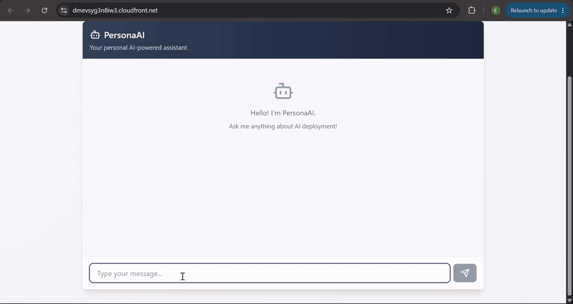
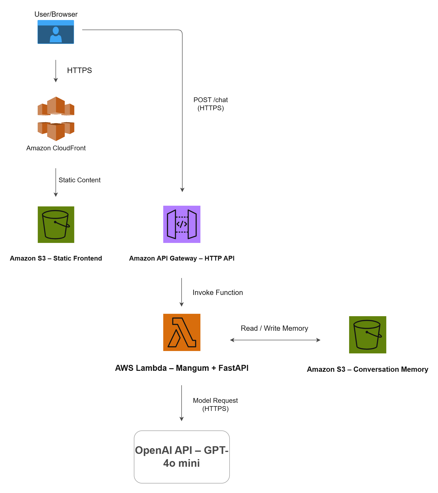
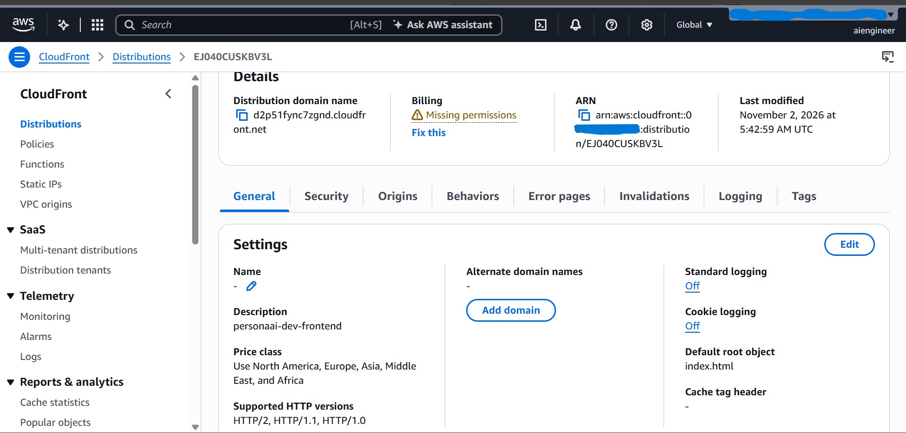
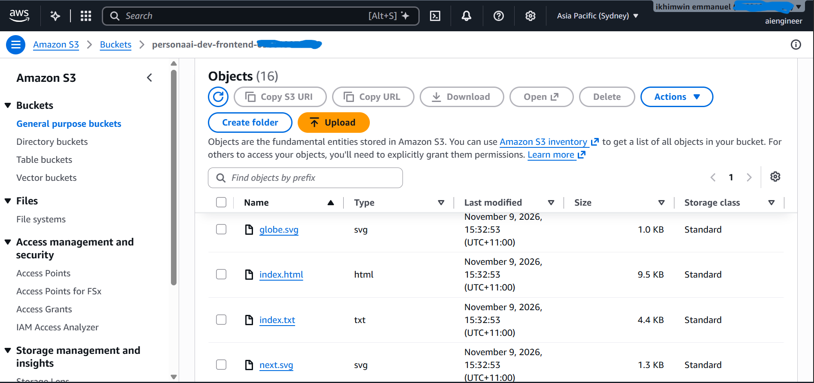
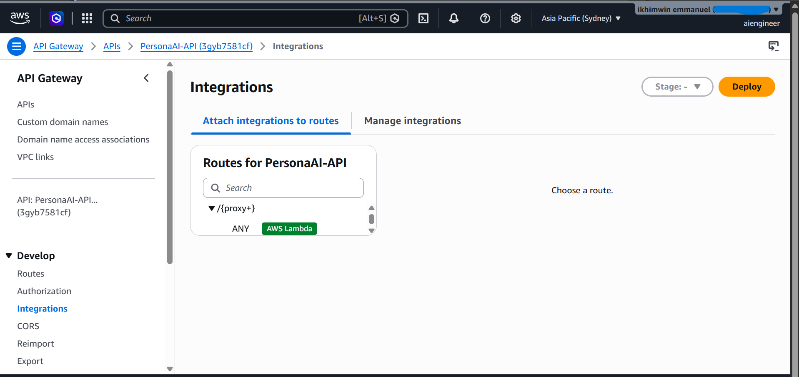
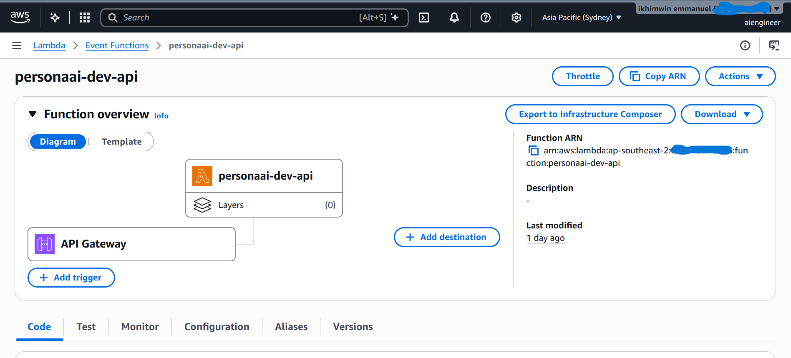

# PersonaAI

PersonaAI is a full-stack AI assistant that answers questions about my professional background, technical skills, experience, and projects.

Built with Next.js and FastAPI, the application uses Amazon Bedrock (Nova 2 Lite) to generate responses using information from JSON, text, and PDF files. Conversation history is stored in Amazon S3, allowing conversations to continue across requests using session IDs.

The application is deployed on AWS, with the frontend hosted on Amazon S3 and delivered through CloudFront, and the FastAPI backend running on AWS Lambda behind API Gateway.
The AWS infrastructure is provisioned using Terraform, with remote state stored in Amazon S3. GitHub Actions automates code validation and deployment to AWS using OpenID Connect (OIDC) for secure authentication.

**Live Demo:** https://d2p51fync7zgnd.cloudfront.net

## Walkthrough



## What the Application Does

Visitors can ask PersonaAI about my education, professional experience, technical skills, and software projects.

When a message is submitted:

1. FastAPI retrieves the conversation history associated with the session ID from Amazon S3.
2. The backend constructs a system prompt using information from JSON, text files, and an extracted resume PDF.
3. The system prompt, conversation history, and user message are sent to Amazon Bedrock using the Converse API.
4. The generated response is returned to the frontend, and the updated conversation is saved to S3.

The application supplies context to the language model at inference time rather than fine-tuning the model.

## AWS Architecture



The Next.js frontend is exported as static files and hosted on Amazon S3. CloudFront delivers the website over HTTPS.

API Gateway forwards chat requests to AWS Lambda, where Mangum connects the Lambda execution environment to FastAPI.

The backend handles AI requests and stores conversation histories in a separate, private S3 bucket.

### Infrastructure as Code

The AWS development environment is provisioned and managed using Terraform. This includes AWS Lambda, API Gateway, Amazon S3, CloudFront, and the required IAM roles and policies.

Terraform state is stored remotely in a private S3 bucket with encryption and state locking enabled, allowing infrastructure changes to be tracked and managed consistently.

## AWS Deployment Screenshots

The following screenshots show the AWS infrastructure used to deploy PersonaAI.

### Amazon CloudFront


### Amazon S3


### Amazon API Gateway


### AWS Lambda



## Tech Stack

| Component               | Technologies                                   |
|-------------------------|------------------------------------------------|
| Frontend                | Next.js, React, TypeScript, Tailwind CSS       |
| Backend                 | Python, FastAPI, Pydantic, Mangum              |
| AI                      | Amazon Bedrock (Nova 2 Lite), boto3            |
| Cloud                   | AWS Lambda, API Gateway, Amazon S3, CloudFront |
| Infrastructure as Code  | Terraform, S3 remote state                     |
| CI/CD                   | GitHub Actions, AWS OIDC                       |
| Development & Packaging | Docker, uv, Git, GitHub                        |

## Deployment and Testing

The FastAPI backend is packaged using Docker to install Linux-compatible Python dependencies before deployment to AWS Lambda.


### CI/CD Pipeline

GitHub Actions runs automated checks for Terraform configuration, Next.js production builds, and Python backend validation on pull requests targeting the main branch.

A separate deployment workflow uses AWS OIDC authentication to securely update the Lambda backend, deploy the frontend to Amazon S3, and invalidate the CloudFront cache.

After deployment, an automated smoke test checks the API health endpoint to verify that the deployed backend is responding.


The following functionality has been tested:

- FastAPI `/health` and `/chat` endpoints running on AWS Lambda.
- API Gateway integration with the Lambda backend.
- Reading and writing session-based conversation histories in Amazon S3.
- Next.js production build and static deployment to Amazon S3.
- Chat functionality through the CloudFront-hosted frontend.
- Local and mocked S3 conversation-storage tests.

The application supports local JSON conversation storage for development and Amazon S3 storage when deployed to AWS.

## Project Structure

```text

PersonaAI/
├── .github/
│   └── workflows/
│       ├── aws-auth-test.yml
│       ├── ci.yml
│       └── deploy-dev.yml
├── backend/
│   ├── data/
│   │   ├── Emmanuel_Resume.pdf
│   │   ├── facts.json
│   │   ├── style.txt
│   │   └── summary.txt
│   ├── context.py
│   ├── deploy.py
│   ├── lambda_handler.py
│   ├── me.txt
│   ├── pyproject.toml
│   ├── resources.py
│   ├── server.py
│   ├── test_storage.py
│   └── uv.lock
├── frontend/
│   ├── app/
│   │   ├── globals.css
│   │   ├── layout.tsx
│   │   └── page.tsx
│   ├── components/
│   │   └── twin.tsx
│   ├── public/
│   ├── next.config.ts
│   └── package.json
├── terraform/
│   ├── backend.tf
│   ├── main.tf
│   ├── outputs.tf
│   ├── variables.tf
│   └── versions.tf
├── scripts/
│   └── deploy.ps1
├── docs/
│   ├── architecture/
│   │   └── personaai-architecture.drawio.png
│   ├── infrastructure/
│   │   └── terraform.md
│   └── screenshots/
│       └── aws/
│           ├── api-gateway.png
│           ├── cloudfront-distribution.png
│           ├── lambda-function.png
│           ├── personaai-infracost-cost-terraform-estimate.png
│           └── s3-frontend.png
├── .gitignore
└── README.md

```

## Local Development

**Prerequisites:** Python 3.12, Node.js, npm, uv, AWS CLI, and configured AWS credentials with permission to invoke Amazon Bedrock.

### Backend

Create a `.env` file inside `backend/`:

```env
DEFAULT_AWS_REGION=us-east-1
BEDROCK_MODEL_ID=global.amazon.nova-2-lite-v1:0
USE_S3=false
CORS_ORIGINS=http://localhost:3000
```

From the `backend/` directory:

```bash
uv sync
uv run uvicorn server:app --reload
```

The API runs at `http://localhost:8000`.

### Frontend

From the `frontend/` directory:

```bash
npm install
npm run dev
```

Open http://localhost:3000.

**Note:** The frontend API endpoint is configured using the `NEXT_PUBLIC_API_URL` environment variable. For local development, set this variable to `http://localhost:8000` in `frontend/.env.local` before starting the Next.js application.


## Current Limitations

- Conversation sessions are identified using session IDs rather than authenticated user accounts.
- The public API uses API Gateway request throttling to limit traffic. However, stronger abuse protection, authentication, and usage quotas would be necessary for a production application serving many users.
- Conversation history is supplied to the model without automatic summarisation or context-window management.


