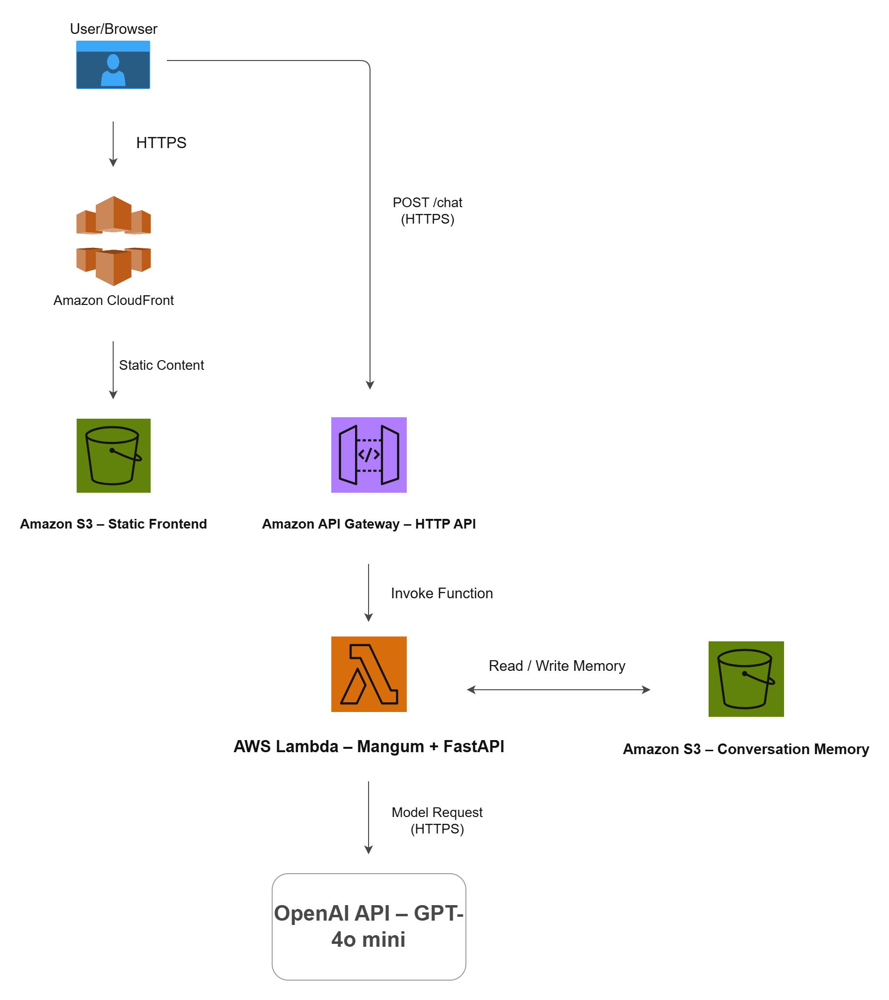
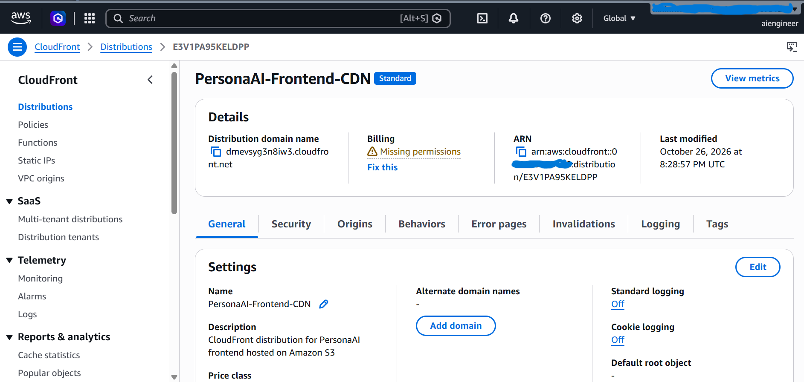
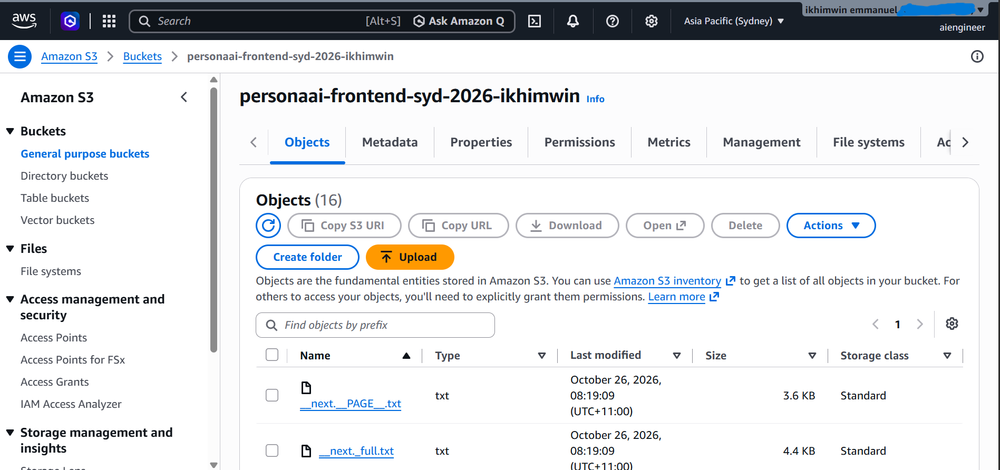
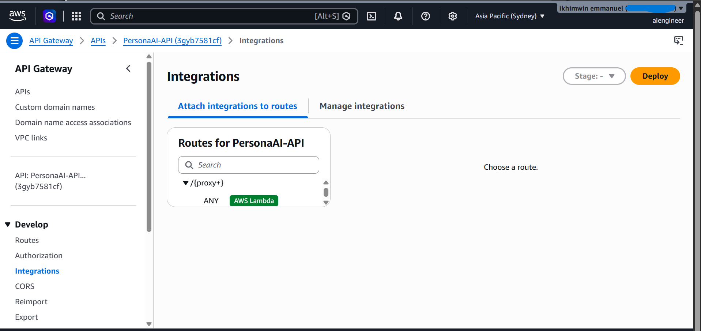
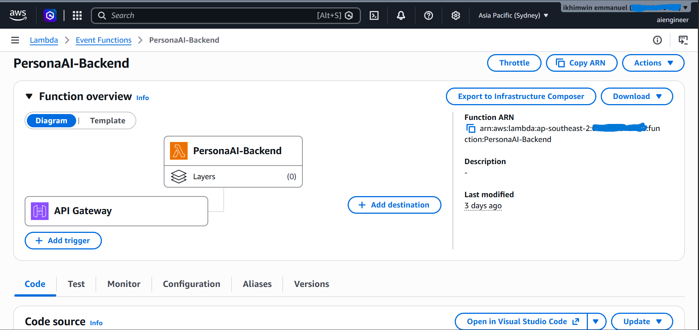

# PersonaAI

PersonaAI is a full-stack AI chatbot that answers questions about my professional background, technical skills, experience, and projects.

Built with Next.js and FastAPI, the application uses the OpenAI API to generate responses using information provided in JSON, text, and PDF files. Conversation history is stored in Amazon S3, allowing conversations to continue across requests using session IDs.

The application is deployed on AWS, with the frontend hosted on Amazon S3 and delivered through CloudFront, and the FastAPI backend running on AWS Lambda behind API Gateway.

**Live Demo:** https://dmevsyg3n8iw3.cloudfront.net

## Walkthrough

<!-- demonstration GIF  -->

## What the Application Does

Visitors can ask PersonaAI about my education, professional experience, technical skills, and software projects.

When a message is submitted:

1. FastAPI retrieves the conversation history associated with the session ID from Amazon S3.
2. The backend constructs a system prompt using information from JSON, text files, and an extracted resume PDF.
3. The system prompt, conversation history, and user message are sent to the OpenAI API.
4. The generated response is returned to the frontend, and the updated conversation is saved to S3.

The application supplies context to the language model at inference time rather than fine-tuning the model.

## AWS Architecture




The Next.js frontend is exported as static files and hosted on Amazon S3. CloudFront delivers the website over HTTPS.

API Gateway forwards chat requests to AWS Lambda, where Mangum connects the Lambda execution environment to FastAPI.

The backend handles AI requests and stores conversation histories in a separate, private S3 bucket.

## AWS Deployment Screenshots

The following screenshots show the AWS infrastructure used to deploy PersonaAI.

### Amazon CloudFront


### Amazon S3


### Amazon API Gateway


### AWS Lambda



## Tech Stack

| Component               | Technologies                                   |
|-------------------------|------------------------------------------------|
| Frontend                | Next.js, React, TypeScript, Tailwind CSS       |
| Backend                 | Python, FastAPI, Pydantic, Mangum              |
| AI                      | OpenAI API (GPT-4o mini)                       |
| Cloud                   | AWS Lambda, API Gateway, Amazon S3, CloudFront |
| Development & Packaging | Docker, uv, Git, GitHub                        |

## Deployment and Testing

The FastAPI backend is packaged using Docker to install Linux-compatible Python dependencies before deployment to AWS Lambda.

The following functionality has been tested:

- FastAPI `/health` and `/chat` endpoints running on AWS Lambda.
- API Gateway integration with the Lambda backend.
- Reading and writing session-based conversation histories in Amazon S3.
- Next.js production build and static deployment to Amazon S3.
- Chat functionality through the CloudFront-hosted frontend.
- Local and mocked S3 conversation-storage tests.

The application supports local JSON conversation storage for development and Amazon S3 storage when deployed to AWS.

## Project Structure

```text
PersonaAI/
├── backend/
│   ├── data/
│   │   ├── facts.json
│   │   ├── summary.txt
│   │   ├── style.txt
│   │   └── Emmanuel_Resume.pdf
│   ├── server.py
│   ├── context.py
│   ├── resources.py
│   ├── lambda_handler.py
│   ├── deploy.py
│   ├── test_storage.py
│   ├── pyproject.toml
│   └── uv.lock
├── frontend/
│   ├── app/
│   ├── components/
│   │   └── twin.tsx
│   ├── next.config.ts
│   └── package.json
├── docs/
│   ├── architecture/
│   │   └── personaai-architecture.png
│   └── screenshots/
│       └── aws/
│           ├── api-gateway.png
│           ├── cloudfront-distribution.png
│           ├── lambda-function.png
│           └── s3-frontend.png
├── .gitignore
└── README.md
```

## Local Development

**Prerequisites:** Python 3.12, Node.js, npm, uv, and an OpenAI API key.

### Backend

Create a `.env` file inside `backend/`:

```env
OPENAI_API_KEY=your_openai_api_key
USE_S3=false
CORS_ORIGINS=http://localhost:3000
```

From the `backend/` directory:

```bash
uv sync
uv run uvicorn server:app --reload
```

The API runs at `http://localhost:8000`.

### Frontend

From the `frontend/` directory:

```bash
npm install
npm run dev
```

Open http://localhost:3000.

**Note:** The frontend currently connects to the deployed API Gateway endpoint. To test against the local backend, change the API URL in `frontend/components/twin.tsx` to `http://localhost:8000/chat`.

## Current Limitations

- Conversation sessions are identified using session IDs rather than authenticated user accounts.
- The public chat endpoint does not yet have comprehensive abuse protection or request throttling.
- Conversation history is supplied to the model without automatic summarisation or context-window management.


